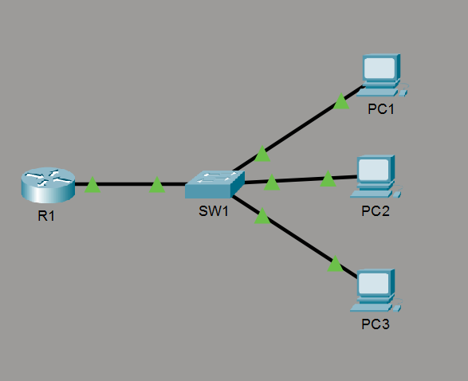

# Day 04: Basic Device Security & Password Management

## 🎯 Overview
This lab focuses on initial hardening practices for Cisco IOS devices (routers and switches). It covers essential device management tasks, including assigning administrative hostnames, configuring local EXEC authentication, analyzing plain-text vs. encrypted passwords, and leveraging Cisco IOS password service encryption.

---

## 📐 Network Topology


### Topology Details
* **Router:** R1 (Cisco Router)
* **Switch:** SW1 (Cisco Catalyst Switch)
* **End Devices:** PC1, PC2, PC3 connected via access ports to SW1

---

## 🛠️ Tasks & Step-by-Step Configuration

### 1. Assign Hostnames
Configure administrative device names on both devices using global configuration mode:

```text
Router> enable
Router# configure terminal
Router(config)# hostname R1
```

```text
Switch> enable
Switch# configure terminal
Switch(config)# hostname SW1
```

---

### 2. Configure Unencrypted Enable Password
Set an initial enable password of `CCNA` on both devices:

```text
R1(config)# enable password CCNA
SW1(config)# enable password CCNA
```

*Verification:* Exit to User EXEC mode and enter Privileged EXEC mode using the password `CCNA`.

---

### 3. Enable Password Service Encryption
Protect plain-text passwords from being viewed in cleartext in the configuration file:

```text
R1(config)# service password-encryption
SW1(config)# service password-encryption
```

---

### 4. Configure Secure Enable Secret Password
Configure a higher-security encrypted password of `Cisco` using MD5 hashing:

```text
R1(config)# enable secret Cisco
SW1(config)# enable secret Cisco
```

---

### 5. Save Configuration
Save the running configuration to the startup configuration on both devices:

```text
R1# copy running-config startup-config
SW1# copy running-config startup-config
```

---

## 🔍 Lab Verification & Questions

### Q1: When both `enable password` and `enable secret` are configured, which password must be used to enter Privileged EXEC mode?
> **Answer:** You must use **`Cisco`** (the `enable secret` password). Cisco IOS prioritizes `enable secret` over `enable password` due to its stronger encryption standard.

### Q2: What encryption type number is used for `enable password` vs. `enable secret` in `show running-config`?
> **Answer:** 
> * **`enable password`:** Uses **Type 7** encryption (a weak, reversible Vigenère cipher derivative).
> * **`enable secret`:** Uses **Type 5** encryption (MD5 hash).

```text
R1# show running-config | include enable
enable secret 5 $1$mERr$2y3...
enable password 7 0822455D0A...
```

---

## 📝 Key Takeaways
1. **Always prefer `enable secret`:** Never rely on `enable password` alone for production devices due to its weak encryption algorithm.
2. **`service password-encryption` scope:** This command obfuscates cleartext passwords in the configuration file to prevent "shoulder surfing," but Type 7 hashes can easily be cracked online.
3. **Configuration Persistence:** Always save active changes with `copy running-config startup-config` (`wr`) to retain settings after a reboot.