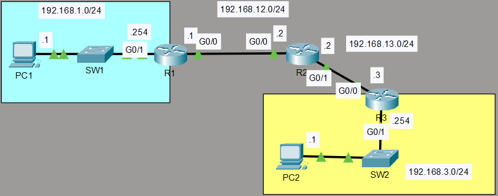

# Configuring Static Routes

## 🎯 Overview

This lab focuses on configuring static routing across a multi-hop router network (R1, R2, R3) to enable end-to-end IP reachability between remote LAN subnets without dynamic routing protocols.

## 📐 Network Topology



### Subnet Details

| Subnet | Range / Mask | Connected Devices / Interfaces |
| :--- | :--- | :--- |
| **PC1 LAN** | `192.168.1.0/24` | PC1 (`.1`), R1 `G0/1` (`.254`) |
| **R1-R2 Link** | `192.168.12.0/24` | R1 `G0/0` (`.1`), R2 `G0/0` (`.22`) |
| **R2-R3 Link** | `192.168.13.0/24` | R2 `G0/1` (`.2`), R3 `G0/0` (`.3`) |
| **PC2 LAN** | `192.168.3.0/24` | PC2 (`.1`), R3 `G0/1` (`.254`) |

---

## 🛠️ Configuration & Implementation

### 1. Host Device IP Configurations

* **PC1 Settings:**
  * IP Address: `192.168.1.1`
  * Subnet Mask: `255.255.255.0`
  * Default Gateway: `192.168.1.254`

* **PC2 Settings:**
  * IP Address: `192.168.3.1`
  * Subnet Mask: `255.255.255.0`
  * Default Gateway: `192.168.3.254`

---

### 2. Router Basic & Interface Configurations

#### Router 1 (R1)
```text
Router> enable
Router# configure terminal
Router(config)# hostname R1

R1(config)# interface gigabitethernet 0/1
R1(config-if)# description Link-to-PC1-LAN
R1(config-if)# ip address 192.168.1.254 255.255.255.0
R1(config-if)# no shutdown
R1(config-if)# exit

R1(config)# interface gigabitethernet 0/0
R1(config-if)# description Link-to-R2
R1(config-if)# ip address 192.168.12.1 255.255.255.0
R1(config-if)# no shutdown
R1(config-if)# exit
```

#### Router 2 (R2)
```text
Router> enable
Router# configure terminal
Router(config)# hostname R2

R2(config)# interface gigabitethernet 0/0
R2(config-if)# description Link-to-R1
R2(config-if)# ip address 192.168.12.2 255.255.255.0
R2(config-if)# no shutdown
R2(config-if)# exit

R2(config)# interface gigabitethernet 0/1
R2(config-if)# description Link-to-R3
R2(config-if)# ip address 192.168.13.2 255.255.255.0
R2(config-if)# no shutdown
R2(config-if)# exit
```

#### Router 3 (R3)
```text
Router> enable
Router# configure terminal
Router(config)# hostname R3

R3(config)# interface gigabitethernet 0/0
R3(config-if)# description Link-to-R2
R3(config-if)# ip address 192.168.13.3 255.255.255.0
R3(config-if)# no shutdown
R3(config-if)# exit

R3(config)# interface gigabitethernet 0/1
R3(config-if)# description Link-to-PC2-LAN
R3(config-if)# ip address 192.168.3.254 255.255.255.0
R3(config-if)# no shutdown
R3(config-if)# exit
```

---

### 3. Static Route Configurations

#### Router R1 Static Routes
R1 needs routes to destination networks `192.168.13.0/24` and `192.168.3.0/24` via next-hop `192.168.12.2`:
```text
R1(config)# ip route 192.168.13.0 255.255.255.0 192.168.12.2
R1(config)# ip route 192.168.3.0 255.255.255.0 192.168.12.2
```

#### Router R2 Static Routes
R2 sits in the middle and needs routes to both end LANs:
```text
R2(config)# ip route 192.168.1.0 255.255.255.0 192.168.12.1
R2(config)# ip route 192.168.3.0 255.255.255.0 192.168.13.3
```

#### Router R3 Static Routes
R3 needs routes back to destination networks `192.168.12.0/24` and `192.168.1.0/24` via next-hop `192.168.13.2`:
```text
R3(config)# ip route 192.168.12.0 255.255.255.0 192.168.13.2
R3(config)# ip route 192.168.1.0 255.255.255.0 192.168.13.2
```

---

## 🔍 Verification & Routing Table Analysis

### Inspecting Routing Tables (`show ip route`)
Static routes show up in the routing table with the code **`S`**:

```text
R1# show ip route static
     192.168.3.0/24 [1/0] via 192.168.12.2
     192.168.13.0/24 [1/0] via 192.168.12.2
```

### Connectivity Verification
Testing ICMP echo requests from **PC1** to **PC2**:

```text
C:\> ping 192.168.3.1

Pinging 192.168.3.1 with 32 bytes of data:
Reply from 192.168.3.1: bytes=32 time=2ms TTL=125
Reply from 192.168.3.1: bytes=32 time=1ms TTL=125

Ping statistics for 192.168.3.1:
    Packets: Sent = 4, Received = 4, Lost = 0 (0% loss)
```

---

## 📝 Key Takeaways

1. **Two-Way Communication:** Routing requires paths to be configured in **both directions** (outbound and return path). Traffic will be dropped if return static routes are missing.
2. **Next-Hop vs Exit Interface:** Static routes are configured using either the next-hop IP address (`ip route <dest-net> <mask> <next-hop>`) or outbound exit interface.
3. **Administrative Distance:** Static routes have a default Administrative Distance (AD) of **1**, making them highly preferred over dynamic routing protocols (e.g., OSPF AD = 110).